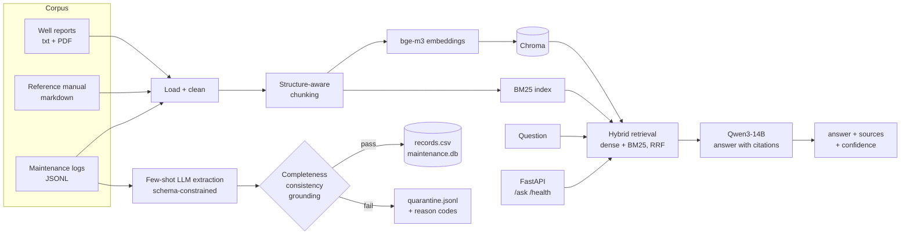

# Field document Q&A for an oil and gas operator

A small, fully local system over a synthetic technical corpus:

1. **RAG pipeline** that answers engineers' questions with cited sources.
2. **Extraction pipeline** that turns free-text maintenance logs into a queryable table, with quality checks and a quarantine file.
3. **Prompt strategy comparison** (zero-shot, few-shot, chain-of-thought) on the extraction task.
4. **FastAPI wrapper** with a Dockerfile and tests.

All four tasks are covered. Every number in this README comes from a file in [outputs/](outputs/) that the scripts regenerate. Limitations are listed in each section and collected at the end.

## Contents

- [Quick start](#quick-start)
- [Architecture](#architecture)
- [The corpus](#the-corpus)
- [Task 1: RAG pipeline](#task-1-rag-pipeline)
- [Task 2: Information extraction](#task-2-information-extraction)
- [Task 3: Prompt engineering (Option A)](#task-3-prompt-engineering-option-a)
- [Task 4: API wrapper](#task-4-api-wrapper)
- [Limitations](#limitations)
- [Repository layout](#repository-layout)

## Quick start

Requirements: Python 3.12, [uv](https://docs.astral.sh/uv/), and two OpenAI-compatible servers, one for chat and one for embeddings. This project was built against:

| Role | Server | Model |
|---|---|---|
| Chat | vLLM | `Qwen/Qwen3-14B-AWQ`, 16k context |
| Embeddings | Hugging Face TEI | `BAAI/bge-m3`, 1024 dimensions |

```bash
cp .env.example .env        # then set the two URLs, keys and model names
uv sync

uv run python -m app.rag.pipeline "What does the manual say about replacing the mud pump seal?"
uv run python scripts/eval_rag.py          # Task 1 evaluation  -> outputs/rag_eval.md
uv run python -m app.extraction.run        # Task 2             -> outputs/records.csv, maintenance.db, quarantine.jsonl
uv run python -m app.prompts.run_eval      # Task 3             -> outputs/prompt_eval.md
uv run pytest                              # Task 4 tests (offline)
uv run uvicorn app.api.main:app --port 8000
```

The corpus is committed, so nothing needs regenerating. To rebuild it: `uv run python scripts/generate_corpus.py`.

Configuration is read from `CHATBOT_*` environment variables or `.env` ([src/app/config.py](src/app/config.py)):

| Variable | Meaning |
|---|---|
| `CHATBOT_LLM_URL`, `CHATBOT_LLM_API_KEY`, `CHATBOT_LLM_MODEL` | Chat server base URL (ending `/v1`), key, served model name |
| `CHATBOT_EMBED_URL`, `CHATBOT_EMBED_API_KEY`, `CHATBOT_EMBED_MODEL` | Embedding server base URL, key, served model name |
| `CHATBOT_LLM`, `CHATBOT_EMBEDDER` | Provider names. Only `openai` (the OpenAI-compatible protocol) is implemented |
| `CHATBOT_TOP_K`, `CHATBOT_HYBRID` | Passages per question (default 5); BM25 fusion on or off (default on) |

## Architecture



Design choices that apply throughout:

- **No orchestration framework.** The whole RAG pipeline is a few hundred lines of plain Python. Every step is readable and every decision below points at the code that implements it.
- **One module talks to the models** ([src/app/llm.py](src/app/llm.py)). Everything else is testable without a GPU.
- **Qwen3 thinking mode is switched off** for every call. Left on, the model spends its token budget on a `<think>` block before answering.

## The corpus

Synthetic, 12 documents, generated by [scripts/generate_corpus.py](scripts/generate_corpus.py):

| Type | Files | Content |
|---|---|---|
| Well completion reports | 8 (6 `.txt`, 2 `.pdf`) | Appendix fields plus Summary, Operations Overview, Issues Encountered, Recommendations |
| Reference manual | 1 `.md` | 17 subsections under System Overview, Component Specifications, Fault Diagnosis, Maintenance Schedules |
| Maintenance logs | 3 monthly `.jsonl` files, 42 entries | Appendix fields; `log_text` is the free-text paragraph |

**Structured truth first, prose second.** Each document starts as a record built with a seeded random generator. The LLM only turns the record into prose, and the script rejects any draft that drops a required number, ID or name. The records are saved to [data/gold/](data/gold/) and are the ground truth for every evaluation below. This is what makes the accuracy figures checkable rather than judged by eye.

Things built into the corpus on purpose:

- The same action is phrased several ways ("replaced the seal", "seal swap carried out", "changed out the piston seal").
- Engineers sign as a full name, initial and surname, surname only, or initials only.
- Dates appear as ISO, `17/03/2025`, `14 March 2025`, `March 14, 2025`, or not at all.
- **6 of the 42 log entries are deliberately defective** (missing equipment tag, malformed tag, malformed fault code, impossible date, future date, unsigned) so the quarantine path has real input.
- The two PDFs carry a running header and page footer for the loader to strip.

Where it falls short of the brief: the manual is about 4,000 words (roughly 8 pages), not 15 to 20. The brief notes two to three paragraphs per section is enough for a demo, and that is what each subsection has.

## Task 1: RAG pipeline

Code: [src/app/rag/](src/app/rag/).

### Ingestion and cleaning

[loaders.py](src/app/rag/loaders.py) reads `.txt`, `.md`, `.pdf` (pypdf) and `.jsonl`. Cleaning is light: Unicode normalisation, dash normalisation, whitespace collapse, and removal of PDF header and footer lines.

### Chunking

Chunking follows each document's own structure rather than a fixed window ([chunking.py](src/app/rag/chunking.py)). The result is 99 chunks.

| Document type | Strategy | Chunks | Why |
|---|---|---|---|
| Well report | One chunk for the header fields, then one per numbered section. Each chunk is prefixed with the well ID and section name | 40 | Questions target a section ("issues during completion of Well X"). The prefix lets a section be matched and understood without its neighbours |
| Manual | One chunk per subsection, prefixed with its heading path. The fault-code table is kept whole | 17 | A subsection is one topic. A table row is useless without its header |
| Maintenance log | One entry per chunk, prefixed with log ID, equipment tag, fault code and date | 42 | Entries are short and self-contained. Splitting or merging them would only blur which entry a fact came from |

- **Size cap: 300 words** (about 400 tokens). Large enough to hold a whole procedure, small enough that five chunks use under a fifth of the 16k context, and far below the embedding server's 2,048-token input limit.
- **Overlap: 45 words** (about 60 tokens, 15%), applied on sentence boundaries only when a section exceeds the cap.
- **Honest note:** in this corpus no section exceeds the cap (median chunk 62 words, largest 286), so the overlap setting never fires. It is a guard rail for longer documents, not something this evaluation exercises.

### Embeddings

`BAAI/bge-m3` served by TEI. Reasons: it is a strong open retrieval model, it runs locally so no document leaves the network, it needs no query prefix, and its long input window means no chunk is ever truncated. Trade-off: 1024-dimension vectors are larger than a MiniLM-class model's 384, which is irrelevant at 99 chunks but would matter for storage at millions.

### Vector store

Chroma in persistent, in-process mode with cosine distance ([store.py](src/app/rag/store.py)). It stores metadata next to vectors, needs no server, and the index is a directory. FAISS would also work but needs a hand-rolled metadata store alongside it.

### Retrieval: dense plus BM25

Dense retrieval alone has a specific weakness on this corpus: sibling IDs embed almost identically. Asked about `MUD-PUMP-04`, dense search ranked four entries for `MUD-PUMP-01` and `MUD-PUMP-02` above the only `MUD-PUMP-04` entry.

The fix is a BM25 keyword ranking fused with the dense ranking by reciprocal rank fusion. The tokenizer keeps hyphenated IDs as single tokens, so `MUD-PUMP-04` and `FLT-0392` are exact-match terms. This moved that entry from rank 5 to rank 1 (question Q3 below).

### Answering and citations

[pipeline.py](src/app/rag/pipeline.py) shows the model the top 5 passages, numbered and labelled by document type. The prompt requires a citation after every statement, exact copying of numbers and IDs, and the fixed reply "Not found in the documents." when the passages do not answer. The response lists only the passages the answer actually cites, each with document name, chunk reference and similarity:

```
$ uv run python -m app.rag.pipeline "How often is the BOP stack pressure tested?"
The BOP stack is pressure tested every 21 days [3].

  [3] drilling_equipment_reference_guide.md#14  (similarity 0.72)

confidence: high - Answer cites 1 passage(s); best match similarity 0.72.
```

Chunk references are `<file>#<section number>` for reports and the manual, and `<file>#<log id>` for log entries.

### Evaluation

Five questions with known answers, plus one negative control. Full outputs are in [outputs/rag_eval.md](outputs/rag_eval.md), produced by [scripts/eval_rag.py](scripts/eval_rag.py).

| # | Question | Correct chunk retrieved? | Answer faithful to source? | Notes |
|---|---|---|---|---|
| Q1 | What were the issues during completion of WELL-2847-NX? | Yes, rank 3 of 5 (rank 2 with dense only) | Yes. All 6 expected facts, cited to the Issues section | Hybrid cost one rank here; the chunk still reached the model |
| Q2 | What does the manual say about replacing the mud pump seal? | Yes, rank 1 | **Faithful but incomplete.** 2 of 4 expected facts | Gives seal orientation and the 1350 Nm torque. Omits the run-in step (40 strokes per minute for 15 minutes) and opens with the 500-hour interval from a different section |
| Q3 | What happened to MUD-PUMP-04 in the maintenance logs? | Yes, rank 1 (rank 5 with dense only) | Yes | The case that justified adding BM25 |
| Q4 | Why was WELL-1975-NW only partially completed? (PDF) | Yes, rank 1 | **Mostly.** Facts are right (upper zone completed, bridge plug at 3785 m) | The report never states *why* the lower zone was isolated. The answer presents what was done as the reason |
| Q5 | Which wells had H2S detected during clean-up? | Yes, all 4 relevant chunks in the top 5 | Yes. All 4 wells, each with its ppm value and its own citation | Works only because 4 chunks fit in the top 5. With more matching wells some would be dropped silently |
| N1 | What is the daily production rate of WELL-2847-NX in barrels? (not in corpus) | n/a | Yes. Replied "Not found in the documents." | Best similarity was 0.60, as high as for answerable questions |

Across all six answers, every number the model wrote appears in a passage it cited.

**What changed between runs.** The first run ([outputs/rag_eval_prompt_v1.md](outputs/rag_eval_prompt_v1.md)) was worse. Q2 was answered from the schedule section and a well report, with none of the procedure. Q3 mixed in a well report although the question asked about the logs. Q4 speculated about a cause. Three rules were then added to the prompt: answer only from the document type the question names, answer from the most direct passage with its specifics, and do not infer causes. The table above is the second run. Because the prompt was adjusted against these same six questions, this is not a held-out result.

**Where it falls short:**

- **Completeness is not checked.** Q2 shows a correct, cited answer that drops half the procedure. For safety-relevant procedures the right design is to return the whole section verbatim rather than a summary.
- **Aggregation is out of reach of top-k retrieval** (Q5). "Which wells..." and "how many..." questions belong on the structured table from Task 2, not on the vector index.
- **Six questions is a smoke test**, not a measurement.

### Confidence note

`confidence` is a heuristic with three levels ([pipeline.py](src/app/rag/pipeline.py)):

| Level | When |
|---|---|
| low | The model declined, or the answer cites nothing |
| medium | Best cited passage has cosine similarity between 0.50 and 0.60 |
| high | Best cited passage has similarity of 0.60 or more |

It is not a calibrated probability. bge-m3 similarities sit in a narrow band here: answerable questions scored 0.54 to 0.72, while the unanswerable N1 scored 0.60. Similarity alone cannot separate them. The model's refusal is the signal that does the real work, and Q2 was rated "high" despite being incomplete.

## Task 2: Information extraction

Code: [src/app/extraction/](src/app/extraction/). Run: `uv run python -m app.extraction.run`.

### Method and justification

A prompted LLM (few-shot, the best strategy from Task 3) with its output constrained to a JSON schema by the server's guided decoder. The fields the lab asks for mix identifiers with judgement: "the fix is temporary and a follow-up check is needed" has to become `pending`, and "seal swap carried out" has to become the same value as "replaced the seal". An LLM handles that variation with no training data. spaCy or a Hugging Face NER model would need labelled examples for custom entities such as fault codes and would still need a second stage for status and action normalisation. The cost is speed and the risk of invented values, which the checks below are there to catch. Constrained decoding removes malformed JSON as a failure mode altogether.

The extractor reads only `log_text` and the entry `timestamp`. The raw files also carry `equipment_id`, `fault_code` and `engineer_name` columns, as the appendix schema specifies, but those are never shown to the model.

### Division of labour

| Step | Who | What |
|---|---|---|
| Copy | LLM | `equipment_id`, `fault_code`, `engineer_name` and `date` exactly as written, or null |
| Interpret | LLM | `fault_description`, `action_taken`, `action_category`, `resolution_status` |
| Normalise | Python ([normalise.py](src/app/extraction/normalise.py)) | Upper-case IDs, parse the date to ISO, fall back to the entry timestamp when the text gives no date (recorded in `date_source`) |
| Validate | Python ([quality.py](src/app/extraction/quality.py)) | The checks below |

The model is asked to copy dates rather than convert them. Parsing in Python means an impossible date fails loudly instead of being quietly "corrected".

**Phrasing variation** is handled by `action_category`, a nine-value controlled vocabulary ([catalog.py](src/app/catalog.py)): `seal_replacement`, `bearing_replacement`, `part_replacement`, `lubrication`, `recalibration`, `pressure_test`, `cleaning`, `inspection`, `other`. The raw phrase is kept in `action_taken` beside it. In the output, "piston seal was changed out", "seal swap carried out" and "changed out the piston seal" all carry `seal_replacement`.

### Quality checks and quarantine

| Check | Rule | Reason code |
|---|---|---|
| Completeness | `equipment_id`, `fault_description`, `action_taken`, `engineer_name`, `date`, `resolution_status` all present (`fault_code` is optional) | `MISSING_FIELD` |
| Consistency | Date parses and is not later than the entry timestamp | `BAD_DATE` |
| Consistency | Equipment ID matches `^[A-Z]+(-[A-Z]+)*-\d{2}$` | `BAD_EQUIPMENT_ID` |
| Consistency | Fault code, if present, matches `^FLT-\d{4}$` | `BAD_FAULT_CODE` |
| Grounding | `equipment_id`, `fault_code` and `engineer_name` appear verbatim in the entry text | `NOT_IN_SOURCE` |
| Parse | The model reply was unusable | `LLM_PARSE_ERROR` |

A record failing any check goes to [outputs/quarantine.jsonl](outputs/quarantine.jsonl) with its reason codes, a human-readable detail, the original text and whatever was extracted. Nothing is repaired automatically.

**The grounding check was added because of a failure found while testing.** One entry says only "the top drive", with no tag. The model returned `TOP-DRIVE-01`: well-formed, plausible and invented. It passed the format check and was written as a clean record. Requiring copied values to appear in the source text catches this class of error, and it is the check I would keep if I could keep only one.

### Results

42 entries processed in about 11 seconds: **36 clean records, 6 quarantined**. Full report: [outputs/extraction_report.md](outputs/extraction_report.md).

Outputs for the analyst: [outputs/records.csv](outputs/records.csv) and the `maintenance_records` table in `outputs/maintenance.db` (SQLite).

```sql
-- sqlite3 outputs/maintenance.db
SELECT resolution_status, COUNT(*) FROM maintenance_records GROUP BY 1;
-- escalated|9   pending|11   resolved|16
```

Field accuracy against gold, over all 42 entries:

| Field | Correct |
|---|---|
| equipment_id | 41/42 |
| fault_code | 42/42 |
| fault_description | 42/42 |
| action_taken (scored on `action_category`) | 38/42 |
| engineer_name | 42/42 |
| date | 42/42 |
| resolution_status | 42/42 |

All six planted defects were quarantined, and no sound entry was:

| Entry | Defect planted | Reason raised |
|---|---|---|
| LOG-0010 | Fault code `FLT-39A` | `BAD_FAULT_CODE` |
| LOG-0011 | No equipment tag | `NOT_IN_SOURCE` (expected `MISSING_FIELD`; the model invented a tag, see above) |
| LOG-0012 | Date in 2052 | `BAD_DATE` |
| LOG-0019 | Tag `DRAWWORKS1` | `BAD_EQUIPMENT_ID` |
| LOG-0031 | Unsigned | `MISSING_FIELD` |
| LOG-0036 | Date `31/02/2025` | `BAD_DATE` |

**Where it falls short:**

- **The four `action_category` errors are in clean records and nothing flags them.** "Annular element swap" was labelled `part_replacement` instead of `seal_replacement` (twice), and "recharged the accumulator bottles" was labelled `lubrication` and `pressure_test` instead of `recalibration`. The category boundaries are fuzzy and the definitions need tightening, or the category should be derived from the fault code where one exists.
- **The model that wrote the log entries also extracts them.** That flatters accuracy. Real engineer text will be messier.
- **Engineer names are not resolved to people.** "JO", "Okafor" and "James Okafor" stay three different values. Resolving them needs a crew roster.
- **Dates are assumed day-first.** `03/04/2025` is read as 3 April.

### Scaling to 500,000 entries

At the measured rate of about 4 entries per second on one 14B model, 500,000 entries would take roughly a day and a half, so the first step is throughput: raise client concurrency to fill vLLM's continuous batching, run several replicas, and try a smaller model on the copy-only fields. A regex pre-pass can take equipment IDs, fault codes and dates without the LLM at all, leaving it only the fields that need judgement, and results should be cached by a hash of the entry text so reruns and duplicates cost nothing. The job itself becomes a resumable batch (a queue or Spark job writing Parquet partitioned by month, with the quarantine as its own table), and a sampled human audit tracks accuracy over time, since at that volume the 10% category error rate seen here means tens of thousands of wrong labels.

## Task 3: Prompt engineering (Option A)

Code: [src/app/prompts/](src/app/prompts/). Run: `uv run python -m app.prompts.run_eval`. Full prompts, inputs and raw outputs: [outputs/prompt_eval.md](outputs/prompt_eval.md).

**Task:** extract the Task 2 fields from a free-text log entry by prompting alone. Schema-constrained decoding is switched **off** here, so the scores reflect the prompts and not the decoder.

**Prompt variants** ([strategies.py](src/app/prompts/strategies.py)). All three share one field guide, so no variant knows more about the fields than another.

| Strategy | What it adds to the field guide |
|---|---|
| Zero-shot | "Reply with one JSON object" |
| Few-shot | Two worked examples, hand-written and not from the corpus. One has every field; the other has no tag, no fault code and no date, to show nulls |
| Chain-of-thought | "Go through the eight fields in order, quoting the supporting words for each, then write the final JSON" |

**Rubric** ([scoring.py](src/app/extraction/scoring.py)), 7 points per input, one per lab field:

- `equipment_id`, `fault_code`, `engineer_name`, `date`, `resolution_status`: 1 for an exact match with gold (null matching null counts), else 0.
- `action_taken`: 1 if the normalised `action_category` matches gold, else 0.
- `fault_description`: 1 if it keeps at least 60% of the gold description's content words, 0.5 for at least 30%, else 0.
- An unparseable reply scores 0 on all fields.

### Results on the five test inputs

Each input was chosen for one hard case.

| Input | Why it is hard | Zero-shot | Few-shot | Chain-of-thought |
|---|---|---|---|---|
| LOG-0003 | Note form, `dd/mm/yyyy`, initials only, escalated | 7/7 | 7/7 | 7/7 |
| LOG-0011 | No equipment tag (must return null, not guess) | 6/7 | 6/7 | 7/7 |
| LOG-0016 | "Annular element" swap should map to `seal_replacement` | 6/7 | 6/7 | 5/7 |
| LOG-0028 | No fault code, initials only, ungrammatical action | 7/7 | 7/7 | 7/7 |
| LOG-0029 | No calendar date ("this shift") | 7/7 | 7/7 | 6/7 |
| **Total** | | **33/35** | **33/35** | **32/35** |
| Valid JSON | | 5/5 | 5/5 | 5/5 |
| Average prompt tokens | | 486 | 762 | 535 |
| Average output tokens | | 95 | 85 | 352 |

Five inputs cannot separate zero-shot from few-shot, so the same three prompts were also run over all 42 entries:

| Strategy | Total | equipment_id | fault_description | action_taken | engineer_name |
|---|---|---|---|---|---|
| Zero-shot | 286/294 | 41/42 | 42/42 | 38/42 | 39/42 |
| Few-shot | **289/294** | 41/42 | 42/42 | 38/42 | **42/42** |
| Chain-of-thought | 277.5/294 | 41/42 | 40.5/42 | 37/42 | 33/42 |

`fault_code`, `date` and `resolution_status` were 42/42 for every strategy.

### Reflection

Few-shot worked best, though the margin is small: it tied zero-shot on the five test inputs and won by three points over the full set. The whole of that gain is `engineer_name`. Zero-shot returned null for three entries that end in bare initials ("... PR"), and the second example, which ends in "HB", was enough to fix all three. That is what examples are good for: showing a convention the instructions describe but the model does not reliably apply. The cost is 57% more prompt tokens per call. Chain-of-thought was the worst and the most expensive, at about four times the output tokens. Asking the model to quote evidence for every field made it stricter than the task wants: it lost `engineer_name` on nine entries, typically reasoning that the entry "does not mention the engineer's name" because a trailing "LE" is not introduced as one. Its one win was LOG-0011, where reasoning step by step led it to return null for the missing tag while both other prompts invented `TOP-DRIVE`. No strategy fixed the `action_category` confusions, which points at the category definitions rather than the prompting style. Few-shot is therefore what Task 2 uses, with the grounding check covering the invented-tag failure that few-shot does not prevent.

One disclosure: after the first run ([outputs/prompt_eval_fieldguide_v1.md](outputs/prompt_eval_fieldguide_v1.md)) the shared field guide gained one sentence, telling the model to give the reason for the work as `fault_description` when nothing was wrong (routine checks). All three strategies were rerun with it. The ranking did not change.

## Task 4: API wrapper

Code: [src/app/api/main.py](src/app/api/main.py). Tests: [tests/test_api.py](tests/test_api.py).

### Endpoints

`POST /ask`

```bash
curl -X POST localhost:8000/ask -H 'Content-Type: application/json' \
  -d '{"question": "How often is the BOP stack pressure tested?"}'
```

```json
{
  "answer": "The BOP stack is pressure tested every 21 days [3].",
  "sources": [
    {"document": "drilling_equipment_reference_guide.md",
     "chunk_id": "drilling_equipment_reference_guide.md#14", "score": 0.72}
  ],
  "confidence": {"level": "high", "note": "Answer cites 1 passage(s); best match similarity 0.72."},
  "needs_human_review": false
}
```

`needs_human_review` is true whenever confidence is low. A question the corpus cannot answer returns "Not found in the documents.", an empty `sources` list and `needs_human_review: true`.

`GET /health`

```json
{"status": "ok", "documents_indexed": 12, "chunks_indexed": 99,
 "llm_reachable": true, "embedder_reachable": true}
```

`status` is `degraded` if either model server is unreachable or nothing is indexed.

### Docker

```bash
docker build -t field-qa .
docker run --env-file .env -p 8000:8000 field-qa
```

The index is built on first start. Model URLs and keys come only from `--env-file`; nothing secret is in the image, and the container runs as a non-root user.

**Networking note.** The container must be able to reach the model servers. If they are only reachable through a VPN on the host, as they were during development, Docker's default bridge network cannot route to them and `/health` reports `degraded`. Use the host's network instead, which serves the API on host port 8000:

```bash
docker run --env-file .env --network host field-qa
```

Both modes were tested: bridge mode started and correctly reported `degraded`; host mode indexed 12 documents and answered `/ask`.

### Tests

```bash
uv run pytest     # 2 passed
```

One test checks the `/ask` response schema (and that a body with no question is rejected with 422); the other checks `/health`. The pipeline is swapped for a fake through FastAPI's dependency override, so the tests need no model server and no index.

### Productionising on Azure

Push the image to Azure Container Registry and run it on Container Apps behind API Management, with Entra ID for authentication, Key Vault for the model keys and Application Insights for traces of every question, retrieved chunk and answer. Replace the local Chroma directory with Azure AI Search, which provides the same hybrid keyword-plus-vector retrieval as a managed service, and trigger ingestion from Blob Storage events so new documents are indexed as they arrive. The LLM can stay self-hosted on a GPU node pool where data residency requires it, or move to a hosted model. Any answer with `needs_human_review: true` is shown to the engineer with a visible warning and is written, together with its question and retrieved passages, to a Service Bus queue feeding a reviewer screen; reviewer verdicts become a labelled set for tuning the thresholds and for regression tests. Because the confidence heuristic misses confident but incomplete answers (Q2 above), a random sample of high-confidence answers should go to the same queue.

## Limitations

- **Synthetic, small corpus.** 12 documents and 99 chunks. Nothing here says how retrieval behaves at 10,000 documents.
- **One model wrote the corpus and is evaluated on it.** This flatters both extraction accuracy and answer quality. The gold records make the scoring objective, not the task realistic.
- **Tiny evaluation sets, and prompts tuned on them.** Six RAG questions and five prompt-test inputs. Both prompts were revised once after seeing results, as disclosed above.
- **RAG answers can be incomplete while cited and rated high confidence** (Q2).
- **Confidence is a heuristic**, not a calibrated score.
- **`action_category` is 90% accurate** and its errors are not caught by any check.
- **The manual is shorter than specified** (about 8 pages).
- **The chunk overlap setting is untested** on this corpus because no section is long enough to be split.
- **The API has no authentication or rate limiting**, and `/health` takes several seconds when the model servers are unreachable because its two probes (3-second timeout each) run one after the other.

## Repository layout

```
data/raw/            the corpus: well_reports/, manual/, maintenance_logs/
data/gold/           the records the corpus was generated from (ground truth)
outputs/             evaluation reports, records.csv, maintenance.db, quarantine.jsonl
scripts/             generate_corpus.py, eval_rag.py
src/app/
  config.py          settings from CHATBOT_* variables
  llm.py             chat and embedding calls
  catalog.py         equipment IDs, fault codes, action categories
  rag/               loaders, chunking, store (Chroma + BM25), pipeline
  extraction/        schema, extract, normalise, quality, scoring, run
  prompts/           strategies, run_eval
  api/main.py        FastAPI app
tests/test_api.py
Dockerfile
```
